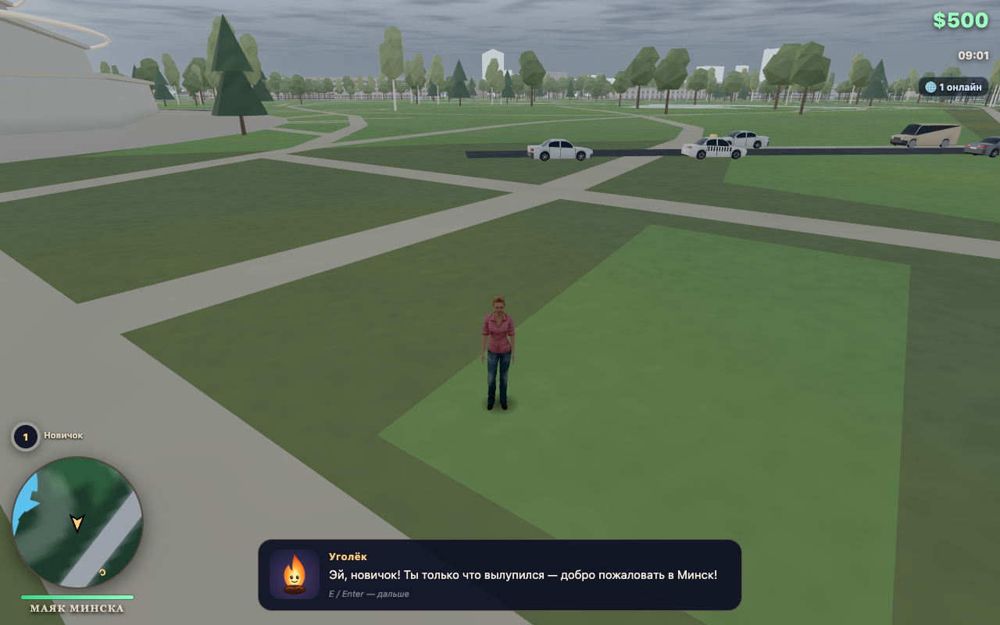
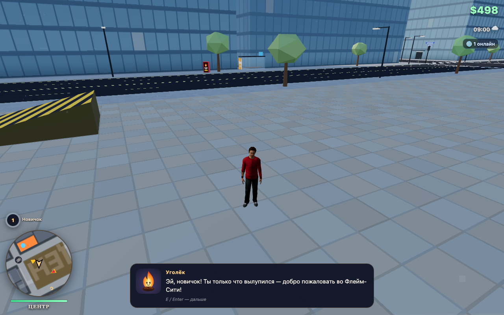
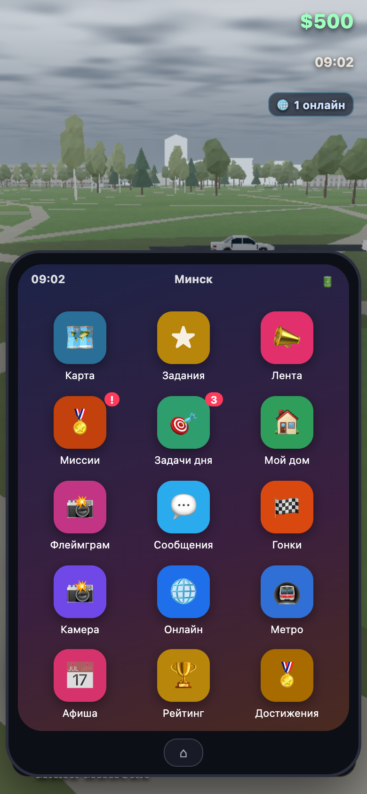

# Флейм-Сити

Браузерная 3D-игра в открытом городе в духе GTA — без установки, на компьютере, телефоне и в Telegram. Два города:
вымышленный **Флейм-Сити** и **«Минск 1:1»**, собранный из данных OpenStreetMap. Онлайн — свой лёгкий сервер на
FastAPI + SQLite.



| | |
|---|---|
|  |  |

## Что внутри

- **Два города**: Флейм-Сити (±1,2 км, районы, река, пляж, горы) и Минск 1:1 — настоящие улицы, дома и адреса из OSM,
  узнаваемые семейства домов (хрущёвки, панельки, сталинки), «Найди свой дом».
- **Машины, вертолёты, самолёты**: 40 типов машин с характером (свои марки-пародии), трафик, трюки и нитро, парашют.
- **Любое здание — внутри**: этажи, лифт, офисы с людьми, работа за столом (мини-игры), магазины, банк.
- **Экономика**: работы, покупка настоящих зданий, бизнесы с сотрудниками, свой дом и гараж, «Передел» районов.
- **Онлайн**: другие игроки рядом, гонки недели, «коп против вора», совместный налёт, друзья, кланы, война за районы,
  рейтинги и уровни.
- **Сюжет и миссии**: история с талисманом Угольком, 11 миссий с медалями, секреты и пасхалки, события города.
- **Фоторежим и повтор**, сторис в Telegram, ссылка-телепорт в точку.
- Люди — сригованные модели Microsoft Rocketbox; без крови; вместо полиции — вымышленный «Патруль «Щит»».
- Чистый JavaScript без сборщика (модули-IIFE), three.js r160, бюджеты под телефоны.

## Быстрый старт

```bash
npm i && npx playwright install chromium   # зависимости и браузер для headless-проверки
npm run dev                                # клиент: http://localhost:8080/  (Минск — ?city=minsk)
```

Онлайн (по желанию, в другом окне):

```bash
python3 -m venv .venv && . .venv/bin/activate
pip install -r server/requirements.txt -r server/requirements-dev.txt
cd server && uvicorn app:app --host 127.0.0.1 --port 8091 --ws websockets
```

`npm run dev` проксирует `/g/*` на :8091. Без сервера игра работает одна — открывай с `?gs=off&mp=off`, тогда она не
стучится к серверу. Проверки: `npm run lint`, `npm test` (pytest сервера), `npm run check` (headless: оба города без
ошибок и без запросов за пределы своего адреса; без запущенного сервера — `QS="&gs=off&mp=off" npm run check`).

## Устройство

```
client/   страница и ~55 модулей на window.FC (порядок — index.html), config.js — настройки выкладки,
          data/zones.js, minsk/ (OSM, ODbL), people/, cars/, tex/, brand/, vendor/three-r160.js
server/   игровой сервер: app.py (сокет, сохранения), realty, modes, progress, crews, war, media, events; tests/
tools/    dev-server, headless-проверка, конвейеры: Минск из OSM, машины, люди (Blender), сборка three, трассы
docs/     ARCHITECTURE.md, DEPLOY.md, AUTH.md
```

- [docs/ARCHITECTURE.md](docs/ARCHITECTURE.md) — модули, контракты `FC.*`, Минск, ассеты, как добавить зону, миссию,
  машину, город.
- [server/README.md](server/README.md) — ручки, схема, честность, личность.
- [docs/DEPLOY.md](docs/DEPLOY.md) — своя выкладка (статика + uvicorn + прокси с WebSocket).
- [docs/AUTH.md](docs/AUTH.md) — вход: гость по умолчанию, внешний аккаунт — по желанию.

## Как добавить…

- **Зону** — строка в `client/data/zones.js`; **миссию** — запись в `client/fmissions2.js`; **машину** — тип в
  `client/fcarlist.js` + `npm run cars`; **город** — данные по образцу `client/minsk/` (`tools/minsk-osm.py`).
  Подробно — ARCHITECTURE.md «Как добавить».

## Правила содержания

Игра должна быть безопасной для показа в Беларуси и где угодно: никаких настоящих брендов, логотипов, эмблем машин;
никакой настоящей милиции/ОМОНа и госсимволики — только «Патруль «Щит»»; госздания — фон без имён, мемориалы — тихие
зоны, храмы не продаются; без политики и без крови. Свободного текста в онлайне почти нет (эмоции из списка, чат клана —
через фильтр). Подробно — ARCHITECTURE.md «Право и содержание».

## Лицензии

Код и собственные ассеты — **MIT** ([LICENSE](LICENSE)). Данные Минска (`client/minsk/`, `client/tex/minsk-landmarks.json`)
— **ODbL 1.0, © участники OpenStreetMap**, не MIT. Люди — Microsoft Rocketbox (MIT, © 2020 Microsoft) и Quaternius (CC0),
three.js — MIT. Всё — в [ASSETS.md](ASSETS.md).

Участие — [CONTRIBUTING.md](CONTRIBUTING.md), правила общения — [CODE_OF_CONDUCT.md](CODE_OF_CONDUCT.md), уязвимости —
[SECURITY.md](SECURITY.md).

---

## English

**Flame City** is an open-world 3D browser game in the spirit of GTA that runs without installation on desktop, mobile
and inside Telegram. It has two cities: the fictional *Flame City* and *Minsk 1:1*, built from OpenStreetMap data
(real streets, buildings and addresses). Multiplayer is served by a small FastAPI + SQLite game server.

**Features:** cars (40 types with distinct handling, parody brands only), helicopters, planes and parachutes; enter any
building (floors, elevators, offices with people, desk jobs as mini-games); jobs, buying real buildings, businesses with
employees, your own home and garage; online play with races, cops-and-robbers, co-op heists, friends, clans, district
wars, levels and leaderboards; a story with 11 medal missions, secrets and city events; photo mode and instant replay.
No blood, no real police or state symbols (a fictional "Shield Patrol" instead), no real brands.

**Quick start:**

```bash
npm i && npx playwright install chromium               # deps + browser for the headless check
npm run dev                                            # client at http://localhost:8080/ (add ?city=minsk; offline: &gs=off&mp=off)
pip install -r server/requirements.txt -r server/requirements-dev.txt
cd server && uvicorn app:app --port 8091 --ws websockets   # optional multiplayer server (dev server proxies /g/*)
npm run lint && npm test && npm run check               # eslint, server pytest, headless smoke test (no server: QS="&gs=off&mp=off" npm run check)
```

**Architecture:** plain-JavaScript IIFE modules attached to `window.FC` (no bundler), a trimmed three.js r160 build,
and a Python game server with its own SQLite database. Players are guests by default; an optional external account
provider can be plugged in (client config + server webhook, see `docs/AUTH.md`). Self-hosting: `docs/DEPLOY.md`.
Code comments and docs are in Russian; issues and pull requests in English are welcome too.

**License:** code and own assets — MIT. Minsk map data — ODbL 1.0 (© OpenStreetMap contributors), not MIT.
Rocketbox models — MIT (© 2020 Microsoft); Quaternius animations — CC0; three.js — MIT. See `ASSETS.md`.
